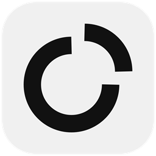

<div align="center">
  

  # Lemora

  **All your remote connections in one fast, encrypted Windows app.**

  [](LICENSE)
  [](#)
  [](https://dotnet.microsoft.com/)
  [](https://github.com/CODEX-cpp/Lemora/releases/latest)
  [](https://github.com/CODEX-cpp/Lemora/releases)
  [](https://github.com/CODEX-cpp/Lemora/stargazers)
  [](https://github.com/CODEX-cpp/Lemora/commits/main)
  [](https://github.com/1Remote/1Remote)
</div>

---

Lemora keeps **RDP, VNC, SSH, SFTP/FTP, Telnet and external apps** in a single window, organised in folders, with saved credentials that are encrypted on disk, detachable tabs and a quick launcher you can open from anywhere (<kbd>Alt</kbd> + <kbd>M</kbd>).

It was built for people who look after **many customers and many servers** and are tired of three different address books, shared password sheets and "which IP was the NAS again?". A folder is a customer; the credentials, the domain, the IP range and the device passwords of that customer live in the folder, and every connection inside inherits them.

It is a fork of [1Remote](https://github.com/1Remote/1Remote) (GPL-3.0), reworked with a new look, an encrypted data vault, a team mode with its own server, and an automatic update system.

## Key features

- 🖥️ **One app for every protocol**: RDP, VNC (own viewer, Tight encoding, clipboard), SSH, SFTP/FTP, Telnet and any external program, as tabs you can drag out into their own windows
- 📁 **Customers as folders**: nested folders with a domain, an IP prefix and shared credentials that every connection inside inherits
- 🔒 **Encrypted data vault**: connections and secrets are encrypted with AES-GCM; unlock with a master password or Windows Hello
- 🔑 **Folder password manager**: during an RDP or VNC session a side tab opens the passwords of the devices of that customer (NAS, switches, DVR…): search, copy user, password or IP, never shown in clear unless you ask. The clipboard is cleared after 30 seconds
- 👥 **Team mode**: a small Lemora Server (Windows service, web console) shares folders, connections, credentials and device passwords with every PC of a team. Each PC is approved by an administrator and gets *read*, *requests* or *write* permission; the activity is logged
- ⌨️ **Quick launcher** (<kbd>Alt</kbd> + <kbd>M</kbd>), a global search and an integrated terminal for SSH and Telnet
- 📄 **`.mora` files**: double-click a file to open a connection, share it with a colleague
- 🎨 **Fluent look**: light and dark themes that follow Windows, rounded "islands" layout, list, card and tree views
- 🌍 **Multilingual** interface
- 🔄 **Self-updating**: checks GitHub for a new release whenever you bring the window to the front, downloads it in the background, verifies its digital signature and asks you to restart; Windows asks for permission once

## Install

Download `Lemora.exe` from the [latest release](https://github.com/CODEX-cpp/Lemora/releases/latest) and run it. The first time it asks how you want to use it:

| Mode | Where it lives | Data |
| --- | --- | --- |
| **Portable** | wherever the file is | next to the file, nothing is installed |
| **Local** | `C:\Program Files\Lemora` for all users | one encrypted database per Windows user |
| **Teams** | `C:\Program Files\Lemora` for all users | local encrypted copy **plus** the shared data of your Lemora Server |

*Local* and *Teams* install a small stable `Lemora.exe` launcher and keep every version in its own folder (`versions\<version>\`), so an update never overwrites a program that is running.

## Self-updating

The installed app checks `https://github.com/CODEX-cpp/Lemora/releases/latest` at most every two minutes, only when its window is shown (never while it sits in the tray). A release must contain exactly two files besides the installer:

```text
lemora-<version>-update-package.zip       Lemora.exe at the root of the zip
lemora-<version>-update-package.zip.sig   ECDSA P-256 signature, base64
```

The tag must be `v<version>` (for example `v1.3.1.11105`). The signature is checked twice, once when the package is downloaded and again by the elevated helper that installs it, with the public key compiled into the app. A package that does not match is deleted and never used.

## Tech stack

- **App**: C# on .NET 10, WPF, with native RDP (MSTSC ActiveX) and a managed VNC viewer; a Rust launcher (`Installer/launcher`) for the versioned install layout
- **Storage**: SQLite, with passwords and secrets encrypted by the vault
- **Lemora Server**: ASP.NET Core (Kestrel) + SQLite, a small single-page web console, no external dependencies
- **Windows only** (RDP and the window host rely on Win32 and COM)

## Building from source

Requirements, build commands and notes for contributors are in [DEVELOP.md](DEVELOP.md). In short:

```bash
dotnet build Ui/Ui.csproj -c Release
dotnet test Tests/Tests.csproj -c Release
```

To make the single-file `Lemora.exe` and the files of a release:

```bash
powershell -File Installer/make-exe.ps1
powershell -File Installer/update/make-release.ps1
```

The release script needs the private signing key of the maintainer (`Installer/update/new-keys.ps1` creates a pair for your own fork: replace `PublicKeyB64` in `Ui/Setup/UpdateService.cs` with yours).

## Project structure

```text
Ui/                  the app (WPF): views, services, protocols, setup and update code
Server/              Lemora Server (ASP.NET Core) and its web console (wwwroot)
Installer/           single-file exe script, Rust launcher, update keys and release scripts
Tests/               xUnit tests
VncSharpCore/        VNC library (customised)
Dragablz/            detachable tabs (customised)
Shawn.Utils/         shared helpers
ui-map/tools/        end-to-end test scripts and fake servers
```

## License and credits

[GNU General Public License v3.0](LICENSE). Lemora contains code © VShawn and the [1Remote](https://github.com/1Remote/1Remote) contributors under the same license; the bundled libraries keep their own licenses (see the folders of [Dragablz](Dragablz), [VncSharpCore](VncSharpCore) and `Ui/Resources`).
